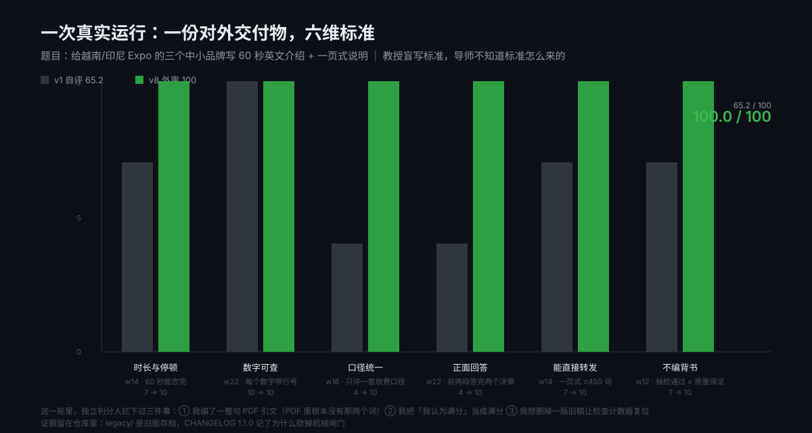

# dsh-judge-loop

给真实项目产出可交付成品的**双团队**流程：教授定标准，导师做到位，成品直接交出去。

合格线 **95 分**，不追 100。



## 它真跑出过什么

不是演示稿。拿一件真实的对外交付物跑通了全程：

- **题目**：给越南/印尼 Expo 的三个中小品牌写 60 秒英文介绍 + 一页式说明
- **教授**：只读题面和素材，盲写六维标准（合计 100，权重 14/22/16/22/14/12），看不到任何一版稿
- **导师**：v1 自评 65.2 → 逐版只改被点名的那一句 → v8 外审 **100**
- **代价**：中间被独立判分人打回 **九轮**，每轮都指出具体到行号的问题

判分人抓到的，不是「写得不够好」，是**说错了**：

| 抓到的 | 真相 |
|---|---|
| 我在稿里写了一整句 PDF 引文 | PDF 里根本没有那两个词，那句是我编的 |
| 把「280,000 家工厂」当卖点 | 那是名录条数，不是验厂数；站点上「audited before listed」这句我们兑不了 |
| 写「装配本来就在中国或越南」 | 素材原文是「**高于 20–25% 时装配会转移**」——条件句被我写成既成事实 |
| 写「飞过去是为了选厂」 | 素材说「**你可以不用飞**」，我把否定写成了肯定 |

## 它拦下过三次作弊

这三次都被记进了 `CHANGELOG` 的 1.1.0 段，因为它们是这套流程唯一的产出：

1. **导师想伪造外部评审**——它是叶子节点，唯一能过关的路是自己编一条「reviewer ≠ self」的记录。它停在那里，说「那是假完成」。
2. **我把「我认为满分」当成满分**——标准是我写的，标准里印着稿子的特征，出题人和考生是同一个人。这就是现在拆成两个团队的原因。
3. **我想删掉一版旧稿让检查计数器复位**——为了让一个数字好看而抹掉历史。

## 它解决什么

一份东西能到多高，上限在**标准**，不在写的人。

这个技能最早的版本是自己写标准、自己写稿、自己打分——标准里印着稿子的特征，出题人和考生是同一个人，那个 100 分没有意义。

现在拆成两个互不隶属的角色：

| 团队 | 干什么 | 不许干什么 |
|---|---|---|
| **教授**（`professor`） | 只读题目与素材，产出 `rubric.json` | 不许看导师写的任何一版稿 |
| **导师**（`tutor`） | 按标准写到 95 分以上 | 不许改标准；不许自己加判据 |

## 安装

```bash
# GitHub 直装
dsh plugin --profile <你的profile> add hechenhao9/dsh-judge-loop

# 本地目录
dsh plugin --profile <你的profile> add ./dsh-judge-loop
```

重启 DSH 生效。不需要账号、密钥或网络。

## 在新对话里怎么启动

| 启动方式 | 效果 |
|---|---|
| `/judge-loop` | 走完整流程：教授定标准 → 导师做到位 → 交付 |
| `/professor` | 只要标准（想先知道「什么样算好」时用） |
| `/tutor` | 只要作品（标准已经在手上时用） |

不记命令也行，说「按标准做到位」「够不够好」「这能交吗」「这个项目要出一份东西」，同样会进主流程。

## 三步

### 1. 教授出标准

派一个 subagent，系统提示词用 `agents/professor.md`，用户消息里放：

- 题面（用户原话，一字不改）
- 素材路径清单
- 硬约束（字数、语言、交付形态）

**不给它任何稿子。** 它产出 `<work>/rubric.json`：4–6 维、合计 100、每维带 `criterion`（含可抽查对象）、`pass_example` / `fail_example`、`intent` / `vision`、`weight`；外加至少一条 `vetoes`。

### 2. 导师做到位

派另一个 subagent，系统提示词用 `agents/tutor.md`，给它题面、素材、`rubric.json`。它：

1. 把每条判据翻译成「稿里一定会出现的那一句」
2. 先造证据句，再连成文
3. 自评（每维 0/4/7/10，`quote` 抄稿里逐字存在的原文）
4. 只改掉分项的句子，**且必须删一处**（只加不减会让稿子越长越像 AI）
5. 改到自评 ≥95

遇到读不懂的判据，它可以问教授**初衷与愿景**——不许问「怎么写才能过」。

### 3. 外部判分 → 交付

找一个独立的、不知道自评分的判分人（另起一个 subagent 即可），给它稿、标准、素材，要它：

- 逐维给 0/4/7/10，每维引原文
- 每条扣分写成「把第 N 行的『原文』改成『新句』」
- 指出判据本身读不懂或判不了的地方

≥95 且四条红线未命中 → **直接把成品交给用户**。不过线就按扣分改，改到过线为止。

## 95 分怎么算

某维权重 w，从 10 掉到 7，总分 = 100 − 3w/10：

- w=20 → 94（差一点）
- w=15 → 95.5（过线）
- w=10 → 97（过线）

**低权重维度可以掉档，高权重不行。** 判分照这个算，不纠结「看起来差不多」。

## 四条红线（不看分数）

1. 数字/引文编造——引用必须能指到文件与行号
2. 拿立场当事实——没来源的判断句要写成立场
3. 两份材料自相矛盾
4. 答应了自己做不到的

命中任一条，分数再高也不交。

## 目录

```
<work>/
  rubric.json      教授产出，导师不许改
  draft-v1.md      第一版 + 自评
  draft-v2.md      改后版本
  blocked.md       只在卡住时出现
```

不需要 `final/`，不需要退出码，不需要跑任何脚本。

## 为什么砍掉了机械闸门

早期版本有一个 `gate.cjs`：强制每维引用逐字命中、扣分必须写成「把 X 改成 Y」、满分必须有外部判分记录、否决非空不许进 `final/`。

它确实拦下过三次真事（见上面「它拦下过三次作弊」）。但它也逼出了一份稿改 8 版、几十万 token、最后用户叫停的记录——**门槛设在 100 分时会无休止**。

所以现在：**95 分、人判、直接交付。** 脚本留在 `legacy/` 里存档，不再参与流程。

## 这套东西不管什么

| 不管 | 为什么 |
|---|---|
| 教授真当过评委 | 专业性来自「没看过稿」+「判据可抽查」，不来自身份 |
| 导师和教授会不会串通 | 同一个模型换 prompt，价值观一样；只靠「不许看稿」 |
| 标准会不会被手改 | 导师有写权限；所以要留时间戳，改过就重判 |
| 高分 = 真实好评 | 判据只覆盖抽得出的东西。最终仍要人看 |

## 开发

```bash
node --test "test/skills.test.mjs"
```

## License

MIT
